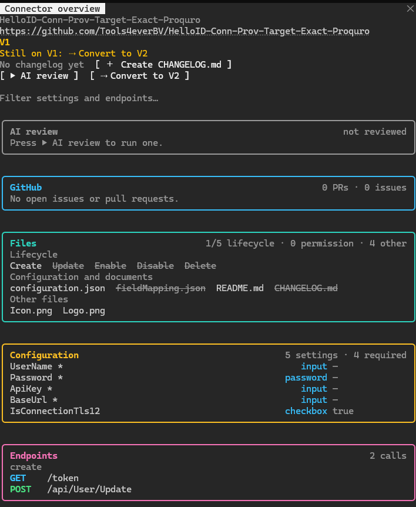

<p align="center"></p>

# helloid-connector

A Claude Code mod that shows a pane for the HelloID connector you are working in. Open a file in a
`HelloID-Conn-*` folder (or `/cd` into one) and the pane fills with the connector's scripts, endpoints,
configuration and versions. It also starts a few actions from the pane: a download of the version on GitHub, and, when the optional
`/ai-reviewer` and `/helloid-v1-to-v2` commands are installed, an AI review and a V1 to V2 conversion.



*The **▶ AI review** and **⇢ Convert to V2** buttons are optional: they only show when `/ai-reviewer` and
`/helloid-v1-to-v2` are installed.*

It is built around **target** connectors (`HelloID-Conn-Prov-Target-*`): the lifecycle scripts, the permission
scripts and the field mapping. It opens for any `HelloID-Conn-*` folder, but the target-only sections are not
meaningful for source connectors.

## Install

The mod is installed from this repository, which is also its marketplace.

1. At the prompt of a Claude Code terminal session, run:

   ```
   /plugin install helloid-connector --marketplace JeroenBL/helloid-connector
   ```

   Or from a shell:

   ```
   claude plugin install helloid-connector --marketplace JeroenBL/helloid-connector
   ```

2. Answer `y` to add the marketplace, then pick a scope (just you, or everyone on the project).
3. Open a file in a `HelloID-Conn-*` folder, or run `/connector-overview`. The pane opens by itself.

To update, run `/plugin` and update `helloid-connector`, or install it again. To try a checkout without installing it,
start Claude Code with `claude --plugin-dir <path to this folder>`.

The GitHub card only looks at repositories under `Tools4everBV` (see Limitations).

**Optional commands.** The **▶ AI review** and **⇢ Convert to V2** buttons only appear when the commands behind
them are installed: `/ai-reviewer` (writes the review the AI review card shows) and `/helloid-v1-to-v2` (the V1 to
V2 conversion skill). Without them the pane still shows the connector, GitHub state and endpoints.

## Command

| Command | What it does |
|---|---|
| `/connector-overview` | Opens the pane for the connector in the working directory, or the last one seen, and asks GitHub again. |

The pane also opens by itself the first time a connector file is read or written, and again when you move into
another connector.

## What the pane shows

**Header**
- The short name of the connector and its folder name.
- Tags: the release from `CHANGELOG.md` (`v1.2.0`), the generation (`V2`, `V1` or `V1 + V2`), and how the release
  compares with GitHub (`↓ GitHub v1.3.0`, `✓ GitHub`, `↑ ahead of GitHub v1.1.0`, `not on GitHub`).
- The repository URL, as a link, when the repository exists on GitHub.
- A **next step** line: the one thing worth doing, by priority (review findings, behind GitHub, still on V1, pull
  requests waiting for review, a release not published yet, else `✓ Up to date`). It names the button that does it,
  and is left out while an action runs or when GitHub has not answered.
- A **release timeline**: the last six releases of both changelogs, `●` when the release is in the local
  `CHANGELOG.md` and `○` when only GitHub has it. Green: both; violet: local only; yellow: GitHub only.
- Actions: **▶ AI review**, **⇩ Download vX.Y.Z** (only while GitHub is ahead of the local release),
  **⇢ Convert to V2**. Each only shows when it can work.
- A line under the header says what the last action did. It stays until you press ✕.

**GitHub**: the open pull requests and issues of the repository (up to 30), each a link. Pull requests come first;
one with reviewers requested is bold with `● review`, a draft is dimmed and tagged `draft`. It sits under the AI
review card and only shows for a repository that exists.

**Files** (lifecycle, permissions, documents)
- The five lifecycle scripts (create, update, enable, disable, delete); a missing one is struck through.
- Permission scripts, grouped by set. In the root, `entitlements.ps1`, `grantPermission.ps1` and
  `revokePermission.ps1` are recognised by name (V1 layout); in a `permissions/` folder they are grouped by folder
  (V2 layout).
- Other scripts, then `configuration.json`, `fieldMapping.json`, `README.md`, `CHANGELOG.md` (struck through when
  missing) and any other root file. Hidden files and folders are not listed.
- Every present chip opens the file in VS Code.

**Configuration**: the settings of `configuration.json`, with required marks. A password field never shows its value.

**Endpoints**: the REST calls found in the scripts, grouped by script, with the base URL and query string
dropped. With two or more scripts calling anything, a grid on top marks which script (`cre`, `upd`, …) calls which
endpoint, 12 rows at most. See [How endpoints are found](#how-endpoints-are-found).

**AI review**: the result of the last `/ai-reviewer` run (findings by severity, open points), or the files being
read while one runs.

**V1 to V2 conversion**: shown only while a conversion runs. See below.

The filter box narrows Configuration and Endpoints. Every card is always open; each has its own accent colour.

## Other things the mod needs

The buttons depend on commands from elsewhere. Without them the button is simply left out.

| Button | Needs |
|---|---|
| ▶ AI review | the `/ai-reviewer` command, which writes `~/.claude/ai-reviews/<connector>.json` |
| ⇢ Convert to V2 | the `/helloid-v1-to-v2` skill |
| ⇩ Download | `git` on the PATH, and network access to GitHub |

The mod checks for the commands with `$.command.list()` on every load.

## Converting from V1 to V2

Press **⇢ Convert to V2** (it fills `/helloid-v1-to-v2 <connector>` in the prompt box), or type the command
yourself. When it is submitted:

1. The model is told, beside your prompt, to convert in place, not to create copies, and never to move or delete a
   script.
2. The pane follows the run. A progress panel shows a bar and one row per step: every script that had a V1 or V2
   marker when the run started, plus `fieldMapping.json` and `README.md`. A script that is off the disk for a
   moment stays listed as waiting.
3. When the **main** turn ends, the line under the header says how it went: `Converted to V2: …` when every script
   is on V2 and both documents were written again, or `Paused: … waiting: …` naming what is left. A pause keeps
   tracking across turns; ✕ stops it.

A script counts as V2 when it uses `$actionContext` or `$outputContext`, and as V1 when it has none of them but uses
`$aRef`, `$pp`, `$p.` or `$auditLogs`. A `backup-v1` folder left by an earlier version of the mod is never scanned.
## GitHub version check and download

The release of the local `CHANGELOG.md` (first `## [x.y.z]` heading) is compared with the same file on GitHub,
`https://raw.githubusercontent.com/Tools4everBV/<folder name>/main/CHANGELOG.md`, then `master`. A repository
without a changelog still counts as on GitHub when `README.md` is there (same branches); it then has no release to
compare, so the card shows the link and the issues and pull requests but no version note. The folder name
must be the repository name. The check runs behind the load, is cached for ten minutes per connector, and
`/connector-overview` forces it again. The open pull requests and issues come from the GitHub API
(`api.github.com/repos/<org>/<folder>/issues` and `/pulls`) in the same run. Only these count against GitHub's limit of
60 an hour without a token: one call for the issues list, plus one for the pull request list when the issues list
holds a pull request. Both are conditional requests (`If-None-Match` with the last `ETag`), and GitHub's `304 Not
Modified` answer does not count, so asking again about an unchanged repository costs nothing. The changelog and
readme come from `raw.githubusercontent.com`, which is not part of that limit. It goes through the host (`$.http.fetch`), so your organization's web-fetch
policy applies. The organization is `GITHUB_ORG` in `hooks/register.tsx`.

**⇩ Download** clones the default branch (`git clone --depth 1`) into a new folder next to the connector, named
after the GitHub version: `<connector>-v1.3.0`. An existing folder is never written to. The clone keeps its `.git`
folder. The version in the folder name is stripped of anything but letters, digits, `.`, `+` and `-`.

## Status colors and icons

One legend for where a release stands against GitHub, in the sync note, the next step and the release timeline:
`✓` green in sync, `↓` amber behind (GitHub has it, you do not), `↑` violet local only (ahead). `STATUS` in
`hooks/register.tsx` holds it.

**＋ Create CHANGELOG.md** appears under the header when the connector has no changelog. It writes a Keep a
Changelog file with a `1.0.0` release dated today and never overwrites an existing file.

## How endpoints are found

The scripts are read as text and scanned for `-Uri` / `Uri =` arguments with a quoted URL or a `$variable`. A
variable resolves to its last plain `$var = "…"` assignment before the call. The method comes from `-Method` /
`Method =` in the same statement or splat (or from a variable), and is GET when there is none.
`"$($url.trim("/"))/rest/api/3/user?x=1"` becomes `/rest/api/3/user`; other `$( … )` and `$name` parts become
`{name}` placeholders.

Not found: URLs built with `+` or `-f`, helper functions with their own parameter (`-Endpoint`, `-Path`), and an
inline `-Uri "…"` with quotes inside it.

## Caching

Each connector's scripts are only parsed again when a script, `configuration.json` or `CHANGELOG.md` changes
(modified time and size). Edits and writes always force a re-read. While a conversion runs, every tool call
refreshes the pane at the cost of one folder listing.

## Limitations

- The GitHub organization is fixed to `Tools4everBV` (`GITHUB_ORG` in `hooks/register.tsx`); other organizations'
  repositories show as `not on GitHub`.
- GitHub allows 60 unauthenticated requests an hour. When the limit is hit (403 or 429) the sync note says
  `GitHub rate limit reached, try again later`, or the GitHub card says the issues and pull requests load later.
  The answer is cached for ten minutes; `/connector-overview` asks again.
- Opening a file in the running editor looks for a VS Code or Cursor window through PowerShell, so it works on
  Windows only; elsewhere it falls back to plain `code`.
- A repository counts as on GitHub when it has a changelog or a readme on `main` or `master`, in upper or lower
  case (`CHANGELOG.md`, `changelog.md`, `README.md`, `readme.md`). Other spellings, or another default branch, show
  as `not on GitHub`.

## Layout

```
.claude-plugin/plugin.json   manifest
hooks/hooks.json             loads register.tsx
hooks/register.tsx           the mod: events, parsing, the pane
types/index.d.ts             the shapes of the state the mod keeps
tests/overview.test.tsx      the mod's tests
```

## Tests

`tests/overview.test.tsx` runs the mod against a faked engine (file system, process, HTTP, commands). It covers the
pane, endpoint detection, V1/V2 detection, the GitHub comparison, the download, the review and the conversion flow.
Run it with your usual mod test command.

## Known limits

- Only a connector's root files are listed, not nested ones, and only `.ps1` scripts up to three folders deep are
  read.
- A private repository, or one under another organization, shows `not on GitHub`.
